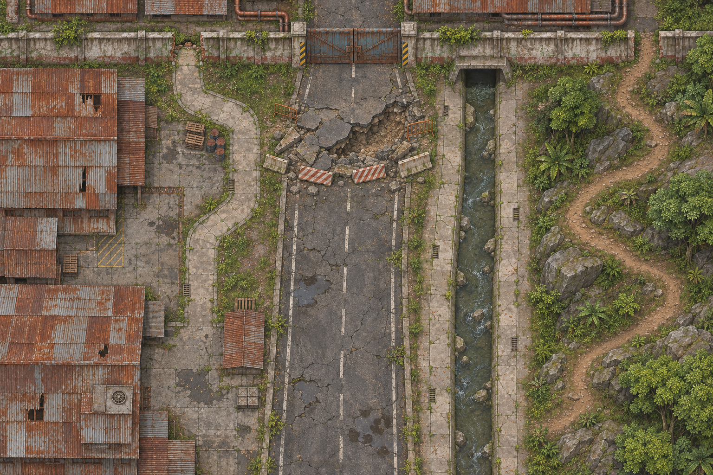
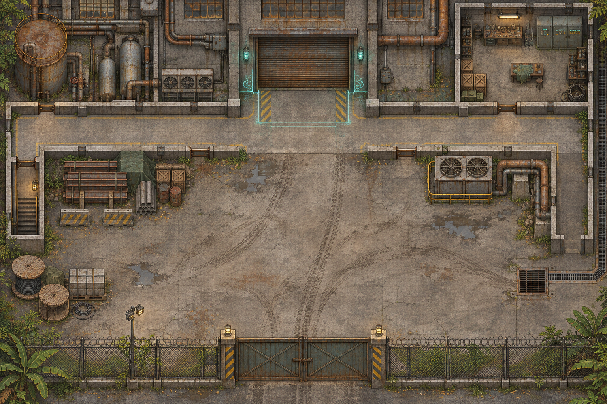
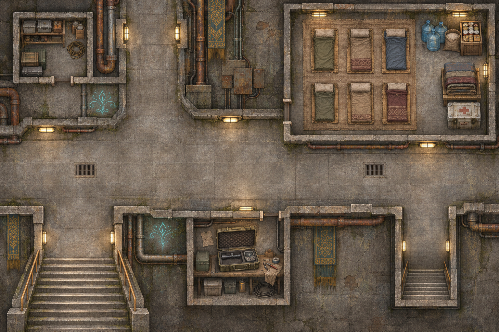
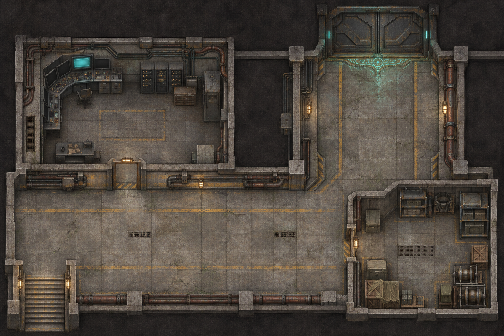

# Mission F — VTT Preparation

**Buka saat setup:** [[Mission F Script]] · [[Mission F Overview]]

**Prep tambahan:** [[Mission F - Combat Preparation|Stat block untuk 5 PC & opsi monster]] · [[Lore/Resonance - Thresholds & Effects Draft|Threshold Resonansi & Echo perkenalan sekali]]. Opsi monster belum memiliki token khusus; gunakan marker abstrak jika dipilih.

Paket: `Assets/Mission F/mission-f-vtt-pack-v1.zip`. Map ada di `Assets/Mission F/Maps/`, token di `Assets/Mission F/Tokens/`. Wulan memakai token milik DM yang sudah ada; tidak dibuat ulang atau disertakan dalam paket ini.

> [!info] Setting grid dalam pixel
> Semua map **1536 × 1024 px**. Isi **Grid Size = 64 px**, square grid, **1 kotak = 5 ft**, offset awal **X = 0, Y = 0**. Hasilnya **24 × 16 kotak** atau **120 × 80 ft**. Ini skala permainan yang dipilih untuk aset, bukan ukuran bangunan canon.
>
> Impor gambar dengan resolusi asli. Jika gambar di-resize menjadi 3072 × 2048 px, grid menjadi **128 px**. Rumus: `grid baru = 64 × (lebar gambar baru / 1536)`. Zoom tampilan layar tidak mengubah nilai sumber ini. Gambar tidak memiliki overlay grid; sambungan beton adalah tekstur, tidak harus sejajar grid.

## Setup singkat

1. Buat scene F1, F2, F3, F4 dengan map dari tabel di bawah. Atur map sebagai background dan lock.
2. Set grid **64 px**, jarak **5 ft**, lalu cek token ukuran **1 × 1 kotak** menempati 64 × 64 px pada skala sumber map. Resolusi file portrait token bukan ukuran grid.
3. Tambahkan enam pekerja di F3: **Bram + Yara + Surveyor 03–06**. Garran, Mara, dan Wizard Generic tidak dihitung sebagai pekerja.
4. Simpan Garran dan wizard tambahan tersembunyi sampai scene memerlukannya. Wizard Generic opsional; duplikasi hanya bila DM memang membutuhkan rekan wizard. Script tidak menentukan jumlah mereka.
5. F4 opsional. Tutupi area belum dieksplorasi dengan fog jika VTT mendukung. Tidak perlu memaksa pemain ke sana untuk menyelesaikan rescue.

| Scene | File map | Grid | Pemakaian |
|---|---|---|---|
| F1 — Approach Route | `F1-Approach-Route.png` | 64 px | Memilih rute alternatif; blocked road bukan jebakan gagal otomatis |
| F2 — Outer Facility | `F2-Outer-Facility.png` | 64 px | Entrance, ward, jalur servis dan drainase |
| F3 — Service Tunnel | `F3-Service-Tunnel.png` | 64 px | Equipment, enam pekerja, negosiasi, jalur ekstraksi |
| F4 — Sublevel 2 | `F4-Sublevel-2.png` | 64 px | Control Room, Research Corridor, Storage, pintu tersegel |

## DM key — baca bersama gambar

Koordinat adalah **pixel pada gambar sumber**, dihitung dari pojok kiri atas; menunjuk pusat area/token, bukan batas tembok presisi. Atas gambar hanya arah layout, bukan utara geografis canon. Pakai posisi ini sebagai saran, sesuaikan gerak party. Detail tata ruang dan penampilan NPC adalah staging visual untuk VTT; belum menjadi actual-play canon.

### F1 — Approach Route

Main road mengarah dari bawah menuju pagar fasilitas di atas dan terhalang runtuhan. Jalur servis dan area industri terbengkalai di kiri, drainase dan jalur bukit di kanan. Party memilih pendekatan; hubungkan rute ke F2 atau langsung F3 sesuai aksi mereka. Tidak ada musuh wajib atau clue rahasia yang ditambahkan oleh gambar.

### F2 — Outer Facility

| Titik | Pusat px (X, Y) | Pakai saat sesi |
|---|---|---|
| Gerbang luar | 768, 910 | Akses dari jalan utama; keadaannya mengikuti narasi script |
| Courtyard | 770, 610 | Tempat party memeriksa jejak; bukan combat wajib |
| Loading entrance + ward | 770, 270 | Investigation DC 10 / Arcana DC 12 sesuai script |
| Tangga servis kiri | 64, 520 | Transisi ke tangga masuk F3 |
| Drainage grate kanan bawah | 1340, 710 | Alternatif akses; jangan jadikan rute buntu otomatis |
| Workshop kanan atas | 1330, 150 | Dressing/cover; tidak otomatis berisi clue baru |

Ward terlihat sebagai garis cahaya; arahnya menahan sesuatu keluar baru dipahami lewat pemeriksaan, bukan label yang terbaca di map.

### F3 — Tunnel, Survivors & Negotiation

| Titik | Pusat px (X, Y) | Pakai saat sesi |
|---|---|---|
| Tangga masuk/keluar | 245, 870 | Hubungkan ke service access F2 atau rute alternatif F1 |
| Equipment box | 735, 780 | Scope, detector, battery dan notebook di script |
| Pintu equipment alcove | 835, 660 | Masuk dari corridor, tidak perlu menembus tembok |
| Refuge pekerja | 1190, 240 | Enam bedroll, air, makanan, medis; tidak ada penyiksaan |
| Pintu refuge | 885, 350 | Diawasi wizard; status terbuka/tertutup mengikuti adegan |
| Junction negosiasi | 750, 510 | Garran bicara saat party hendak membawa pekerja pergi |
| Tangga ke Sublevel 2 | 1320, 850 | Hanya dipakai jika party memilih investigasi |

**Penempatan awal yang disarankan** (semuanya ukuran 1 kotak):

| Token | Pusat px (X, Y) | Catatan |
|---|---|---|
| Bram Kest | 992, 384 | Dekat pintu; yang meminta pertolongan |
| Yara Sen | 1120, 384 | Bersama tim, curiga kepada wizard |
| Surveyor 03 | 1248, 384 | Pekerja ketiga |
| Surveyor 04 | 1376, 384 | Pekerja keempat |
| Surveyor 05 | 1312, 288 | Pekerja kelima |
| Surveyor 06 | 1312, 160 | Pekerja keenam |
| Mara Vell | 800, 352 | Di luar pintu; ragu dengan penahanan |
| Garran Vey | 736, 544 | Munculkan saat negosiasi dimulai |
| Wizard Generic | 1184, 544 | Opsional, bukan tambahan musuh wajib |

Ruangan refuge dan corridor dapat ditampilkan bersamaan saat negosiasi. Saat ekstraksi, pindahkan keenam pekerja sesuai tindakan nyata party; jangan reset posisi mereka saat berganti scene.

### F4 — Optional Sublevel 2

| Titik | Pusat px (X, Y) | Pakai saat sesi |
|---|---|---|
| Tangga masuk | 130, 900 | Tersambung ke tangga kanan F3 |
| Research Corridor | 650, 690 | Jalur antar area; bebas kembali untuk evakuasi |
| Control Room | 370, 340 | Panel aktif di kiri atas, sampaikan **TEMPORAL STABILITY** setelah diperiksa |
| Storage Chamber | 1280, 770 | Dressing; bukan loot/magic item otomatis |
| Pendekatan pintu tersegel | 1160, 400 | Old-Era energy hanya jika party mendekat |
| Pintu Sealed Chamber | 1150, 100 | Indikator **DO NOT RELEASE** disampaikan lewat narasi/handout |

Tidak ada interior Sealed Chamber yang diperlihatkan. Tidak ada makhluk, artefak, pemilik fasilitas, fungsi asli, atau asal-usul yang ditetapkan lewat map. Konsentrasi energi adalah clue sesuai script, bukan pemicu Resonansi otomatis.

## Token roster

Semua token portrait PNG dengan area transparan di luar lingkaran. File resolusi tinggi; atur ukuran tampil **1 × 1 kotak**, termasuk Yara (Dwarf tetap ukuran Medium). Empat pekerja tanpa nama hanya memakai nomor untuk pelacakan; ciri visualnya tidak menetapkan nama, identitas atau backstory canon.

| File dalam `Tokens/`                   | Peran                              | Pembeda visual                   |
| -------------------------------------- | ---------------------------------- | -------------------------------- |
| ![[Garran-Vey.png\|200]] Garran Vey | Human Wizard                       | Robe gelap, tongkat, latar teal  |
| `Mara-Vell.png`                        | Half-Elf Apprentice                | Telinga half-elf, latar biru     |
| `Bram-Kest.png`                        | Human Survey Technician; pekerja 1 | Helm dan vest oranye             |
| `Yara-Sen.png`                         | Dwarf Surveyor; pekerja 2          | Helm kuning, workwear mustard    |
| `Surveyor-03.png`                      | Pekerja 3                          | Helm biru                        |
| `Surveyor-04.png`                      | Pekerja 4                          | Helm putih, vest hijau, kacamata |
| `Surveyor-05.png`                      | Pekerja 5                          | Helm merah                       |
| `Surveyor-06.png`                      | Pekerja 6                          | Helm putih, jaket ungu           |
| `Wizard-Generic.png`                   | Rekan wizard opsional              | Robe hijau; boleh diduplikasi    |

Wulan sudah dimiliki DM dan tidak disertakan. Token PC mengikuti roster sesi, tidak dibuat dalam paket ini.

## Extraction — 3–4 hazard saja

Pilih dan aktifkan berdasarkan keadaan sesi; titik di bawah adalah staging usulan, bukan kejadian yang sudah terjadi.

| Hazard script | Saran letak | Check / konsekuensi sesuai script |
|---|---|---|
| Locked Door | Pintu refuge F3 atau loading entrance F2 | DC 12 Athletics / Thieves' Tools / Arcana; gagal membuang waktu |
| Collapsing Floor | Corridor F3 menjelang tangga kiri | DC 12 Dexterity / Athletics; complication lingkungan |
| Magical Pulse | Junction F3 atau dekat ward F2 | DC 12 CON save; gagal 1d4 force |
| Temporal Distortion | Corridor F4 jika dikunjungi; jika tidak, corridor F3 | DC 12 WIS save; gagal kehilangan Reaction sampai giliran berikutnya |
| Closing Machinery | Loading entrance F2 atau pintu tunnel | DC 12 Dexterity; complication lingkungan |

Tak perlu versi map rusak tambahan: marker atau narasi DM cukup. Gagal check bukan gagal rescue otomatis. Pilihan pemain menentukan siapa terluka, terpisah, atau tertinggal.

## Batas verifikasi

Paket diperiksa secara lokal: gambar dibuka untuk inspeksi visual, dimensi PNG dan alpha token diperiksa, serta arsip ZIP diperiksa integritasnya. **Belum diimpor atau dikalibrasi langsung di VTT pengguna dan belum playtested.** Grid 64 px adalah skala setup yang konsisten; gambar generatif bukan denah arsitektur presisi. Jika dekorasi/tepi pintu bertabrakan dengan snap, prioritaskan jalur yang dapat dilewati sesuai script dan geser token dengan snap sementara dimatikan bila perlu.

Prompt produksi tersimpan di `Assets/Mission F/Production/Prompts.md`; metadata file dan hasil pemeriksaan di `Assets/Mission F/Production/manifest.json`.
